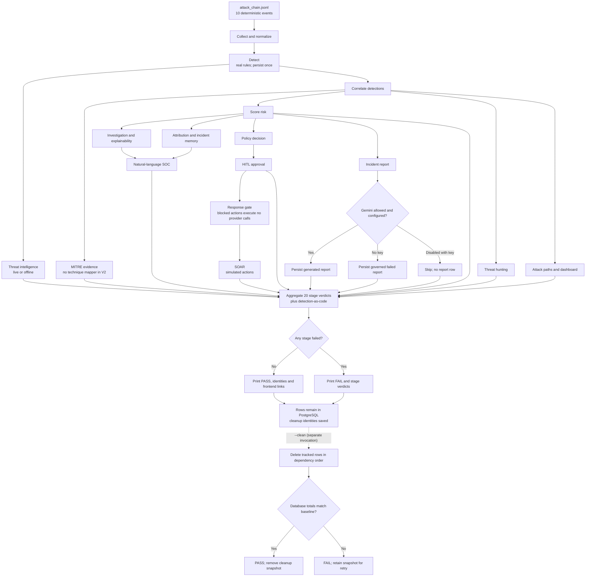

Demo Runbook (`python -m app.cli demo`)
========================================

Purpose
-------

One command that takes a single deterministic dataset through the **real**
SentinelAI pipeline and leaves the results inside PostgreSQL, so the existing
frontend pages have something genuine to show:

.. code-block:: console

   cd backend
   source .venv/bin/activate
   python -m app.cli demo --scenario full

Workflow
--------

It walks the 20-stage checklist in pipeline order, prints a PASS / SKIP /
FAIL verdict per stage, prints the identities it created, and prints
deep links to the *existing* frontend routes (never a new or fake page).

Removing everything again:

.. code-block:: console

   python -m app.cli demo --clean

Nothing is fabricated
---------------------

Every stage calls the shipped agents, services, persistence sinks and
read-models — the same code the running application calls.  In particular:

* detections come from the real ``DetectionAgent`` against the deployed
  Sigma/YARA registry, and the per-event rule failures are persisted too;
* the correlation, risk, approval, SOAR, hunt, memory, report and
  attack-path rows are written by the real persistence services;
* a blocked decision is **proven** to have executed nothing: the response
  registry is wrapped in a call-counting spy, so a ``DENIED`` or
  ``REQUIRES_APPROVAL`` decision is sent to the real executor and must come
  back ``REJECTED`` with **0 provider calls** — otherwise the check fails;
* where a capability genuinely does not exist, the stage says so.  V2 ships
  **no MITRE technique mapper**, so the ATT&CK stage reports
  ``techniques: []`` and ``capability_present: false`` and never invents an
  ATT&CK id.

One incident, not twenty copies
-------------------------------

``10`` events in ``demo_datasets/00_full_soc_scenario/attack_chain.jsonl``
yield 9 matched detections, 3 correlation groups (the primary one holding
the 7 linked detections) and 3 risk assessments.  The demo persists that
incident **once**:

* ``ScenarioContext.ensure()`` returns a cached context while demo mode is
  active, so a downstream command that also asks for the scenario adopts the
  already-persisted rows instead of minting a second set of identities;
* the ATT&CK / risk / correlation facts in the checklist are read from that
  same context, so the ids the checklist prints are the ids that are in the
  database (not a second, in-memory computation — ``correlate()`` mints a
  fresh identity per call);
* a stage that names a correlation that is not the demo's own is a hard
  error, not a silently preferred winner.

Flags
-----

============================  =================================================
``--scenario full``           the shipped scenario (the only one)
``--json``                    machine-readable payload on stdout
``--clean``                   remove every row a run created, then prove the
                              database is back at its pre-run row totals
``--run <run_id>``            with ``--clean``: limit to one run
``--no-gemini``               never call Gemini; when a key *is* configured
                              the report stage reports SKIPPED with the
                              reason (see "Incident reports" below)
``--offline``                 never call a live threat-intelligence provider
``--reject``                  resolve the demo approval as REJECTED
============================  =================================================

Exit codes: ``0`` success, ``1`` a stage failed or cleanup left drift,
``2`` invalid arguments.

Incident reports
----------------

The V2.20 report service owns report persistence: one generation attempt always
writes exactly one ``incident_reports`` row, and ``GET /api/incident-reports``
serves that row to the Incident Reports page.  The demo therefore drives the
real service instead of stopping in front of it:

* **Gemini configured** — the real generator composes a narrative over the
  persisted evidence catalog and persists a ``generated`` row.
* **no key configured** (or ``--no-gemini`` with no key present) — the Gemini
  client raises at construction without any network call, and the service
  persists one governed ``failed`` row carrying a sanitized ``error_code`` /
  ``error_message``, audited as ``incident_report.generated_failed``.  The page
  lists that row.  No report text is ever templated or invented in its place.
* **``--no-gemini`` with a key present** — the operator forbade the model call,
  so the service is not invoked and no row is written; the stage reports
  SKIPPED with the reason.

That row is a tracked identity, so ``--clean`` removes it like any other.

Cleanup and drift
-----------------

``--clean`` restores exactly the rows a run created.  The runner tracks real
identities (primary keys, natural keys, user ids, hunt names) and, for
audit rows written with a null actor, the set of audit ids that existed
before the run.  No pattern or wildcard delete is used.

Snapshots live in ``backend/.demo_state.json`` (git-ignored):

* each attempt is stored **separately** — repeating the demo must not
  overwrite the previous attempt's cleanup data and strand its rows;
* all attempts are then removed in a **single dependency-ordered pass**,
  because attempts deliberately share the deterministic demo users and an
  approval carries a real ``users`` foreign key;
* the post-cleanup row totals are compared against the **oldest** stored
  baseline, so an earlier attempt's rows are not mistaken for drift;
* the snapshots are only forgotten once the restore is proven.  On drift or a
  cleanup error the command reports ``FAIL``, keeps the file, and says which
  table and counts differ — so ``--clean`` can simply be run again.

State file size: the audit watermark stores one id per pre-existing audit
row, so the file is roughly 1 MB per attempt.  Run ``--clean`` when you are
done; the entries disappear on success.

Determinism
-----------

* The dataset, the detection rules and the risk engine are fixed, and the
  demo never reads a wall clock for a value it prints.
* The demo's e-mail addresses are derived from the scenario, so a repeated
  run reuses the same ``users`` rows rather than creating a new identity
  each time; a reused row is never scheduled for deletion.
* Detection, correlation, risk and hunt identities are minted by the
  *production* persistence services (``uuid4`` at persistence time).  They
  are deliberately **not** faked into a fixed value, so two runs produce
  different ids for equivalent content.  The demo reports the ids it
  actually created.
* Threat hunts are pinned to the incident's own time window
  (``DEMO_HUNT_WINDOW``, ±5 minutes).  The dataset's default window is wide
  enough to sweep in unrelated rows, and the hunt engine refuses a surface
  that exceeds its 200-row cap.  The cap itself is never raised or lowered.

What you will see in the frontend
---------------------------------

With the backend on ``:8000`` and Vite on ``:5173``, log in as an existing
user and open any of the printed links — dashboard, incidents, detections,
correlations, risk, threat intelligence, hunts, reports, attack paths, audit.
The demo rows are ordinary rows: the same APIs, the same pages, no demo mode
in the frontend.

Note that every API except ``/health`` requires a JWT; the demo creates
service accounts for its audit trail but no login you can use, so
authenticate with your own account.

Tests
-----

.. code-block:: console

   pytest tests/unit/test_demo_cli.py            # the command's own guarantees
   pytest tests/integration/test_demo_cli_e2e.py # a real run + real cleanup

The end-to-end test runs the command against the real database, asserts the
recorded ids are served by the existing HTTP APIs, that every printed link is
a route the frontend router declares, that the scenario is persisted exactly
once, that a blocked decision made zero provider calls, and that ``--clean``
restores every table.  It cleans up after itself even when it fails.
